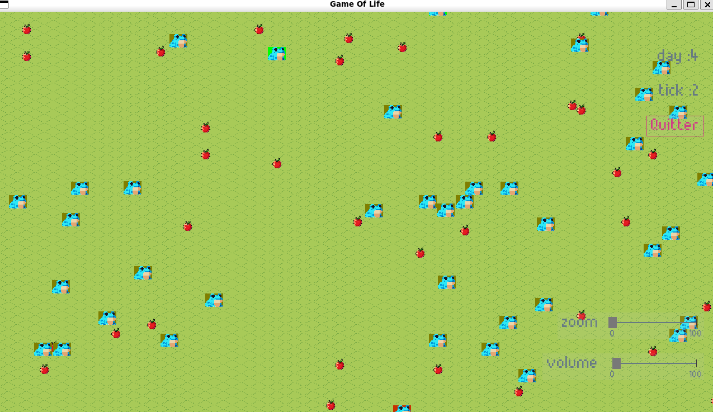
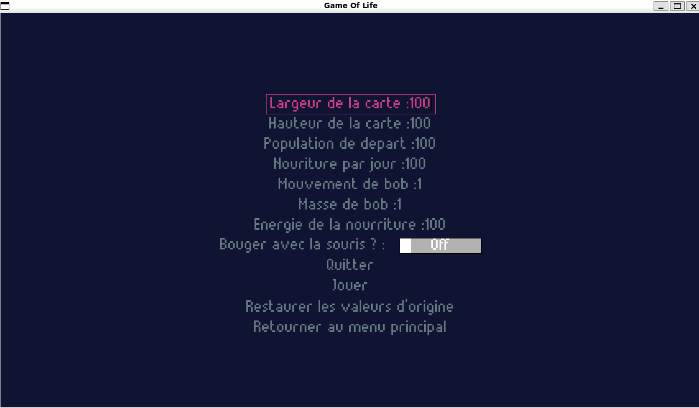

# Evolutionary-Game-of-Life

Software designed to study how civilizations evolve by adjusting various parameters:
* Initial population
* Food availability
* Population growth rate
* Population weight

Automatically simulate the evolution of species, introducing random mutations in each new generation.

The simulation can be adapted to any sprite, allowing you to experiment with different animals, creatures, or environments!




## How to run
Install packages:
```bash
sudo apt install python3-tk
python3 -m venv .venv
source .venv/bin/activate
pip install -r requirements.txt
```

Run:
```bash
python3 main.py
```